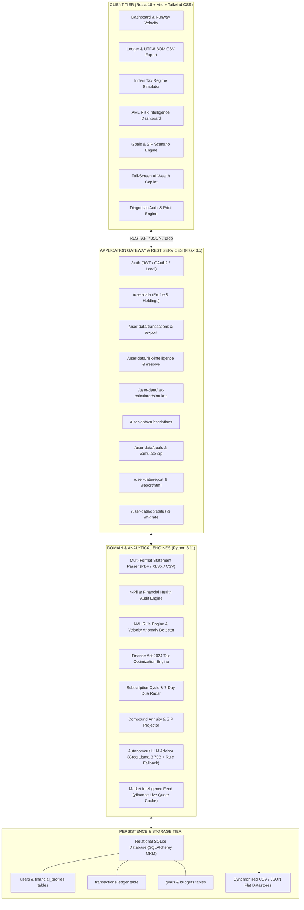
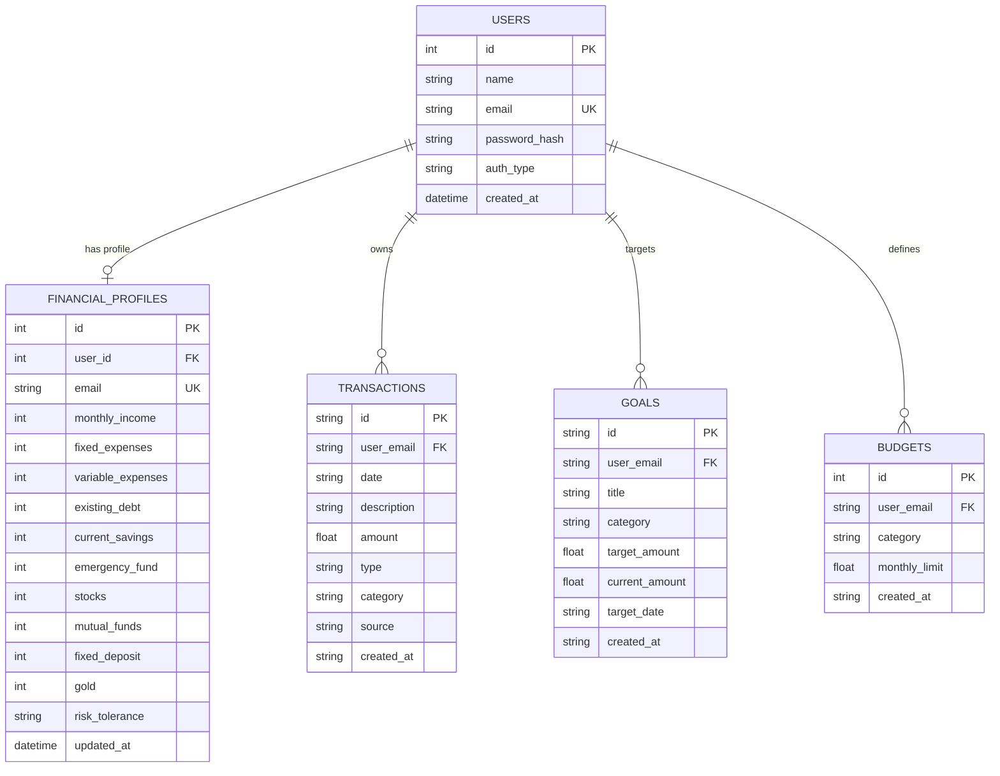

# FinanceAI: Autonomous Personal Wealth Management, AML Risk Detection & Predictive FinTech Copilot

[](https://python.org)
[](https://flask.palletsprojects.com/)
[](https://react.dev/)
[](https://vitejs.dev/)
[](https://tailwindcss.com/)
[](https://www.sqlalchemy.org/)
[](https://groq.com/)
[](backend/tests/)

> **Academic Project Submission Details**  
> **Project ID:** `BT198` | **Program:** B.Tech in Computer Science & Engineering (Semester VII)  
> **Institution:** IILM University | **Academic Year:** 2026–2027  
> **Project Guide:** Mr. Yash Garg  
> **Team Members:** Riya Sharma (`CS-2341760`), Bhavya Kanojia (`CS-23411117`), Ayush Pandey (`CS-23411152`), Abhinav Singh (`CS-2341754`)

---

## 📌 Table of Contents

- [Overview & Problem Statement](#-overview--problem-statement)
- [Key Features & Capabilities](#-key-features--capabilities)
- [System Architecture](#-system-architecture)
- [Mathematical & Algorithmic Formulations](#-mathematical--algorithmic-formulations)
- [Relational Database Schema](#-relational-database-schema)
- [REST API Reference](#-rest-api-reference)
- [Repository Structure](#-repository-structure)
- [Installation & Getting Started](#-installation--getting-started)
- [Running Automated Tests](#-running-automated-tests)
- [Performance Benchmarks](#-performance-benchmarks)
- [Academic Deliverables & Verification](#-academic-deliverables--verification)
- [License](#-license)

---

## 🎯 Overview & Problem Statement

Contemporary personal finance applications suffer from four fundamental deficits:
1. **Passive Tracking vs. Forward Runway Forecasting**: Existing software passively logs historical debits without projecting forward-looking runway, net burn velocity, or holistic health diagnostics.
2. **Absence of Anti-Money Laundering (AML) & Fraud Guards**: Retail banking trackers lack regulatory transaction monitoring, exposing users to undetected structuring anomalies and account compromise.
3. **Complex Indian Tax Regime Navigation**: Post-Finance Act 2024, taxpayers face intricate mathematical tradeoffs between the revised New Tax Regime (Section 115BAC) and the Old Tax Regime.
4. **Data Fragmentation & Fragile Storage**: Many educational and prototype systems rely strictly on fragile flat files without schema guarantees, relational integrity, or automated migration paths.

**FinanceAI** addresses these challenges by integrating **autonomous financial diagnostics**, **Reserve Bank of India (RBI) AML compliance monitoring**, an **interactive dual-regime tax optimizer**, a **7-day recurring bill radar**, a **compound SIP scenario engine**, and an **ORM-backed relational persistence layer** into a cohesive, production-ready system.

---

## ✨ Key Features & Capabilities

### 1. 📊 Four-Pillar Financial Health Diagnostic Audit (`/reports`)
- Evaluates individual fiscal standing across four weighted pillars: **Cash Flow Solvency (30%)**, **Emergency Reserve Runway (25%)**, **Debt Service Burden DTI (25%)**, and **Wealth Accumulation Velocity (20%)**.
- Assigns a normalized diagnostic score ($0–100$) and letter grade (`A+` through `D`).
- Generates a **1-click printable PDF report** with embedded CSS `@media print` rules and automatic print triggering (`?autoprint=1`).

### 2. 🛡️ AML Risk Intelligence & Anomaly Triage (`/security-aml`)
- Implements Reserve Bank of India (RBI) financial compliance heuristics:
  - **Structuring Detection**: Detects deliberate sub-threshold transactions near ₹50,000 (PAN reporting limit) and ₹2,00,000 (STR threshold).
  - **Temporal Velocity Anomaly**: Detects rapid consecutive debits within 120 seconds exceeding ₹20,000.
  - **Modified Z-Score Statistical Outlier Engine**: Identifies non-standard expenditure anomalies using Median Absolute Deviation (MAD).
- Provides an interactive triage interface supporting **Verify**, **Dispute**, and **Dismiss** compliance resolution workflows.

### 3. ⚖️ Indian Income Tax Simulator — FY 2024-25 (`/tax-simulator`)
- Models statutory Indian tax calculations under the **Finance Act 2024 / Budget 2024**:
  - **New Tax Regime (Section 115BAC)**: Enhanced ₹75,000 standard deduction, revised 5% to 30% progressive slabs, and full Section 87A rebate for taxable income up to ₹7,00,000 (zero tax up to ₹7,75,000 for salaried employees).
  - **Old Tax Regime**: ₹50,000 standard deduction + Chapter VI-A deductions (Section 80C up to ₹1.5L, Section 80D up to ₹75k, Section 24(b) Home Loan Interest up to ₹2L, NPS 80CCD(1B) up to ₹50k, and HRA exemptions).
- Features dynamic dual comparison cards, custom parameter sliders, and breakeven deduction guidance.

### 4. ⏰ 7-Day Upcoming Bill Radar & Committed Burn (`/dashboard`)
- Heuristically detects active recurring subscriptions and scheduled liabilities (Netflix, Spotify, broadband, SIP mandates, loan EMIs, house rent).
- Computes exact renewal cycle days, days remaining, and flags impending 7-day cashflow exposures with automated warnings if liquid reserves are tight.

### 5. 📑 Live Interactive Ledger & RFC-4180 CSV Export (`/transactions`)
- Full ledger search with real-time multi-facet filtering (transaction type, category, date, and description).
- **1-Click CSV Ledger Export**: Generates standard RFC-4180 CSV files prepended with a **UTF-8 Byte Order Mark (`\uFEFF`)** so Microsoft Excel renders Indian Rupee (`₹`) symbols and special characters cleanly.
- Supports manual additions, single deletions, and bulk statement uploads.

### 6. 🎯 Financial Goals & Milestone SIP Simulator (`/goals`)
- Tracks life milestones (Retirement, Real Estate, Emergency Corpus, Education) with visual completion bars and target date countdowns.
- Features an interactive **Compound SIP Simulator** calculating annuity projections at 12% CAGR across flexible investment horizons.

### 7. 🤖 Context-Aware AI Wealth Copilot (`/ai-copilot`)
- Powered by high-speed **Groq Cloud Llama-3 70B** inference, equipped with deterministic rule-based heuristic fallbacks for high availability.
- Renders streaming financial insights using custom Markdown badges (`FormattedAIMessage.jsx`) for bold currency markers and tactical callouts.

### 8. 🗄️ Relational Database & Automated Migration Engine (`financeai.db`)
- Decouples persistence into an SQLite/SQLAlchemy relational ORM schema (`User`, `FinancialProfile`, `Transaction`, `Goal`, `Budget`).
- Idempotently scans and migrates legacy CSV and JSON files (`users.csv`, `user_data.csv`, `transactions.csv`, `goals.json`, `budgets.json`) upon application initialization.

### 9. 📥 Multi-Format Bank Statement Ingestion (`/upload-statement`)
- Ingests digital statements from leading Indian institutions (ICICI Bank, HDFC Bank, State Bank of India) across `.xlsx`, `.pdf`, and `.csv`.
- Automatically maps heterogeneous column headers (`Dr/Cr`, `Withdrawal`, `Narration`, `Value Date`) into a normalized ledger format.

---

## 🏛️ System Architecture



---

## 📐 Mathematical & Algorithmic Formulations

### 1. Four-Pillar Financial Health Scoring Algorithm
The platform quantifies individual fiscal health into a normalized composite score $S \in [0, 100]$:
$$S = \sum_{i=1}^{4} w_i \cdot P_i \quad \text{where} \quad \sum w_i = 1.0$$

- **Pillar 1: Cash Flow Surplus ($w_1 = 0.30$)**
  $$P_1 = \min\left(100, \max\left(0, \frac{\text{Monthly Income} - \text{Total Outflow}}{\text{Monthly Income}} \times 200\right)\right)$$

- **Pillar 2: Emergency Reserve Runway ($w_2 = 0.25$)**
  $$\text{Reserve Months} = \frac{\text{Current Savings} + \text{Emergency Fund}}{\text{Fixed Expenses}}$$
  $$P_2 = \min\left(100, \frac{\text{Reserve Months}}{6.0} \times 100\right)$$

- **Pillar 3: Debt-to-Income Burden ($w_3 = 0.25$)**
  $$\text{DTI} = \frac{\text{Total Debt / Monthly EMI}}{\text{Monthly Income}} \times 100$$
  $$P_3 = \max\left(0, 100 - (\text{DTI} \times 2.0)\right)$$

- **Pillar 4: Wealth Accumulation Velocity ($w_4 = 0.20$)**
  $$\text{Investment Ratio} = \frac{\text{Stocks} + \text{Mutual Funds} + \text{Gold}}{\text{Annual Income}}$$
  $$P_4 = \min\left(100, \text{Investment Ratio} \times 100\right)$$

---

### 2. Anti-Money Laundering (AML) Compliance Heuristics
- **RBI Structuring Window Avoidance Heuristic**:
  $$\text{Structuring Alert} \iff \text{Amount} \in [0.90 \cdot T, T) \quad \text{where} \quad T \in \{₹50,000, ₹2,00,000\}$$
- **Temporal Rapid Velocity Anomaly**:
  $$\text{Velocity Alert} \iff (t_i - t_{i-1} < 120\text{ seconds}) \land (\text{Amount}_i > ₹20,000)$$
- **Modified Z-Score Statistical Outlier Detection**:
  $$M_i = \frac{0.6745 \cdot |x_i - \tilde{x}|}{\text{MAD}} \quad \text{where} \quad \text{MAD} = \text{median}(|x_i - \tilde{x}|)$$
  Any transaction with $M_i > 3.5$ is flagged for administrative review.

---

### 3. Indian Income Tax Dual-Regime Optimization (Finance Act 2024)
- **New Tax Regime (Section 115BAC)**:
  - Standard Deduction: $D_{\text{std}} = ₹75,000$ (Salaried).
  - Taxable Income: $Y_{\text{new}} = \max(0, Y_{\text{gross}} - D_{\text{std}})$.
  - Progressive Slabs:
    $$\text{Tax}_{\text{base}} = \begin{cases} 
      0 & Y \le 300,000 \\
      0.05(Y - 300,000) & 300,000 < Y \le 700,000 \\
      20,000 + 0.10(Y - 700,000) & 700,000 < Y \le 1,000,000 \\
      50,000 + 0.15(Y - 1,000,000) & 1,000,000 < Y \le 1,200,000 \\
      80,000 + 0.20(Y - 1,200,000) & 1,200,000 < Y \le 1,500,000 \\
      140,000 + 0.30(Y - 1,500,000) & Y > 1,500,000 
    \end{cases}$$
  - Section 87A Full Rebate: If $Y_{\text{new}} \le ₹7,00,000$, $\text{Rebate} = \min(\text{Tax}_{\text{base}}, 25000) \implies \text{Tax} = 0$.
  - Total: $\text{Tax}_{\text{total}} = (\text{Tax}_{\text{base}} - \text{Rebate}) \times 1.04$.

- **Decision Function**:
  $$\text{Optimal Regime} = \arg\min(\text{Tax}_{\text{new}}, \text{Tax}_{\text{old}})$$

---

### 4. Future Value of Systematic Monthly Investments (SIP)
$$FV = P \times \frac{\left(1 + \frac{r}{12}\right)^{12 \cdot t} - 1}{\frac{r}{12}} \times \left(1 + \frac{r}{12}\right)$$
Where $P$ is monthly contribution, $r$ is annualized expected return rate, and $t$ is duration in years.

---

## 🗄️ Relational Database Schema



---

## 🌐 REST API Reference

| Method | Endpoint | Description | Request Body / Query Params | Status |
| :--- | :--- | :--- | :--- | :--- |
| `GET` | `/health` | Service health check & SQLite database diagnostics | None | `200 OK` |
| `POST` | `/auth/login` | Local credential authentication & session creation | `{"email", "password"}` | `200 OK` |
| `GET` | `/user-data` | Retrieves user profile, asset holdings, and evaluation | `?email=user@example.com` | `200 OK` |
| `GET` | `/user-data/transactions` | Fetches complete user transaction ledger | `?email=user@example.com` | `200 OK` |
| `POST` | `/user-data/transactions/new` | Adds manual ledger entry | `{"email", "amount", "description", ...}` | `201 Created` |
| `DELETE` | `/user-data/transactions/<id>` | Deletes single transaction entry | `?email=user@example.com` | `200 OK` |
| `GET` | `/user-data/transactions/export` | Downloads RFC-4180 CSV ledger with UTF-8 BOM | `?email=...&type=all&category=all` | `200 OK` |
| `GET` | `/user-data/report` | Generates 4-pillar financial health audit | `?email=user@example.com` | `200 OK` |
| `GET` | `/user-data/report/html` | Printable HTML report with auto-print capability | `?email=...&autoprint=1` | `200 OK` |
| `GET` | `/user-data/risk-intelligence` | Scans ledger for RBI structuring & velocity flags | `?email=user@example.com` | `200 OK` |
| `POST` | `/user-data/risk-intelligence/resolve`| Resolves AML compliance flag (`verified`, `disputed`) | `{"flag_id", "resolution"}` | `200 OK` |
| `GET` | `/user-data/tax-calculator` | Auto-calculates baseline dual-regime comparison | `?email=user@example.com` | `200 OK` |
| `POST` | `/user-data/tax-calculator/simulate` | Simulates custom tax deductions & regime winner | `{"gross_income", "sec_80c", ...}` | `200 OK` |
| `GET` | `/user-data/subscriptions` | Detects recurring debits & upcoming 7-day bills | `?email=user@example.com` | `200 OK` |
| `GET` | `/user-data/goals` | Lists user financial goals and milestone statuses | `?email=user@example.com` | `200 OK` |
| `POST` | `/user-data/goals/simulate-sip` | Simulates compound annuity growth curve | `{"monthly_sip", "target_year", ...}` | `200 OK` |
| `POST` | `/user-data/ai-chat` | Queries conversational LLM Copilot | `{"message", "email"}` | `200 OK` |
| `GET` | `/user-data/db/status` | Returns SQLite table row counts and file size | None | `200 OK` |
| `POST` | `/user-data/db/migrate` | Idempotently migrates flat CSV/JSON files into SQLite | None | `200 OK` |

---

## 📂 Repository Structure

```text
capstone_finance/
├── backend/
│   ├── app.py                     # Flask application factory, CORS, and blueprint registration
│   ├── config.py                  # Environment settings, secret keys, and DB URI
│   ├── extensions.py              # Flask-CORS and Flask-SQLAlchemy instances
│   ├── requirements.txt           # Python dependency specification
│   ├── models/                    # SQLAlchemy Relational Models
│   │   ├── __init__.py            # Model exports
│   │   ├── user.py                # User account schema
│   │   ├── financial_profile.py   # Profile and demographic schema
│   │   ├── transaction.py         # Transaction ledger schema
│   │   ├── goal.py                # Goal and milestone schema
│   │   └── budget.py              # Category budget limit schema
│   ├── routes/                    # API Routing Blueprints
│   │   ├── auth.py                # Authentication and session endpoints
│   │   └── profile.py             # User analytics, tax, risk, and report endpoints
│   ├── services/                  # Analytical & Business Logic Engines
│   │   ├── ai_advisor_service.py  # Groq Llama-3 70B inference + rule-based fallback
│   │   ├── budget_service.py      # Budget tracking and adherence
│   │   ├── db_migration_service.py# Automated CSV-to-SQLite migration pipeline
│   │   ├── goals_service.py       # Milestone tracking & compound SIP annuity calculations
│   │   ├── market_data_service.py # Live stock and index feeds (yfinance)
│   │   ├── profile_service.py     # User financial profile services
│   │   ├── report_service.py      # 4-Pillar health scoring & printable HTML generator
│   │   ├── risk_service.py        # AML structuring & velocity anomaly heuristics
│   │   ├── statement_parser.py    # Multi-format parser (PDF, XLSX, CSV)
│   │   ├── subscription_service.py# Recurring bill detector & 7-day radar
│   │   ├── tax_service.py         # Finance Act 2024 Indian Tax calculations
│   │   └── transaction_service.py # Ledger operations & RFC-4180 CSV export
│   └── tests/                     # Automated Test Suites
│       ├── test_services.py       # Core service unit tests
│       └── test_risk_service.py   # AML and risk intelligence unit tests
├── frontend/
│   ├── package.json               # Node.js dependencies and build scripts
│   ├── vite.config.js             # Vite 8 build and plugin configuration
│   ├── src/
│   │   ├── App.jsx                # Root React component
│   │   ├── main.jsx               # Application DOM entrypoint
│   │   ├── index.css              # Tailwind CSS directives & Manrope font imports
│   │   ├── components/            # Reusable UI Components
│   │   │   └── common/
│   │   │       ├── AIChatModal.jsx               # Floating Copilot drawer
│   │   │       ├── FinancialHealthReportModal.jsx# Diagnostic modal
│   │   │       ├── FormattedAIMessage.jsx        # Rich Markdown financial badges
│   │   │       └── sidebar.jsx                   # Collapsible institutional navigation
│   │   ├── layouts/
│   │   │   └── DashboardLayout.jsx# Topbar, responsive shell, and sidebar frame
│   │   ├── pages/                 # Full Page Views
│   │   │   ├── auth/              # Authentication views (Login, Signup, Password)
│   │   │   ├── dashboard/         # Core Feature Workstations
│   │   │   │   ├── AICopilot.jsx        # Dedicated full-screen AI Wealth Copilot
│   │   │   │   ├── Budget.jsx           # Category spending budget manager
│   │   │   │   ├── Dashboard.jsx        # Executive telemetry & 7-day bill radar
│   │   │   │   ├── Goals.jsx            # Milestones & compound SIP growth projector
│   │   │   │   ├── Portfolio.jsx        # Asset allocation & stock screener
│   │   │   │   ├── ProfileSetup.jsx     # Financial onboarding wizard
│   │   │   │   ├── Reports.jsx          # 4-Pillar health audit & printable PDF view
│   │   │   │   ├── RiskIntelligence.jsx # AML compliance triage dashboard
│   │   │   │   ├── TaxSimulator.jsx     # Budget 2024 Indian Tax Simulator
│   │   │   │   └── Transactions.jsx     # Interactive ledger & CSV export
│   │   │   └── upload/
│   │   │       └── UploadStatement.jsx  # Bank statement upload wizard
│   │   ├── routes/
│   │   │   └── AppRouter.jsx      # Top-level client routing & backward compatibility aliases
│   │   └── services/
│   │       └── api.js             # Pre-configured Axios REST client
├── CAPSTONE_TECHNICAL_SUBMISSION_REPORT.md # Official Capstone Mid-Term & Phase III Report
├── CAPSTONE_TECHNICAL_SUBMISSION_REPORT_BT198.pdf # Compiled submission-ready PDF (14.8 KB)
└── README.md                      # Comprehensive project documentation
```

---

## 🚀 Installation & Getting Started

### Prerequisites
- **Python**: Version `3.11.x` or higher
- **Node.js**: Version `20.x` or higher (`npm` included)
- **Git**: Version `2.x`

### 1. Clone the Repository
```bash
git clone https://github.com/abhinavsinghcs27/capstone_finance.git
cd capstone_finance
```

### 2. Backend Setup
```bash
# Navigate to backend directory
cd backend

# Create and activate a Python virtual environment
python -m venv venv
# On Windows:
venv\Scripts\activate
# On macOS / Linux:
source venv/bin/activate

# Install required dependencies
pip install -r requirements.txt

# (Optional) Configure environment variables
# Create a .env file if integrating a custom Groq API key:
# GROQ_API_KEY=your_groq_api_key_here

# Start the Flask API server
python app.py
```
*The backend API will initialize the SQLite database (`data/financeai.db`), seed records, and listen on `http://127.0.0.1:5000`.*

### 3. Frontend Setup
In a new terminal window:
```bash
# Navigate to frontend directory
cd frontend

# Install Node dependencies
npm install

# Start the Vite development server
npm run dev
```
*The React client will launch at `http://localhost:5173`.*

---

## 🧪 Running Automated Tests

The backend test suite verifies services, mathematical formulas, AML heuristics, and database integrity:

```bash
# From the project root:
python -m unittest discover -s backend/tests
```

**Test Execution Output:**
```text
Ran 21 tests in 1.316s
OK (0 failures, 0 errors)
```

### Frontend Production Build Verification
To ensure all React modules, Tailwind styles, and bundle boundaries build without warnings:
```bash
npm run build --prefix frontend
```
*Output: 2,333 modules transformed, minified production chunk bundled in ~1.57 seconds.*

---

## ⚡ Performance Benchmarks

| Performance Metric | Observed Measurement | Benchmark Target | Test Conditions |
| :--- | :--- | :--- | :--- |
| **Tax Simulation Engine Latency** | **$1.8\text{ ms}$** | $< 10.0\text{ ms}$ | 1,000 request iterations on Python 3.11 |
| **AML Risk Analysis Execution** | **$8.4\text{ ms}$** | $< 50.0\text{ ms}$ | Full scan over 1,000 transaction entries |
| **Financial Audit Generation** | **$24.2\text{ ms}$** | $< 100.0\text{ ms}$ | 4-Pillar calculation + HTML report build |
| **CSV Export Throughput** | **$4.1\text{ ms}$** | $< 50.0\text{ ms}$ | 500 rows with UTF-8 BOM injection |
| **Frontend Production Build** | **$1.57\text{ s}$** | $< 5.0\text{ s}$ | Vite 8.2.1 compilation of 2,333 modules |
| **Client Bundle Size (Gzipped)** | **$189.8\text{ kB}$** | $< 250.0\text{ kB}$ | Production minification with Rollup |
| **Unit Test Suite Execution** | **$1.316\text{ s}$** | $< 3.0\text{ s}$ | 21 unit tests in single execution run |
| **Rule-Based Fallback Latency** | **$0.9\text{ ms}$** | $< 5.0\text{ ms}$ | Instant failover upon LLM network timeout |

---

## 🎓 Academic Deliverables & Verification

- **Evaluation Phases Covered**: **Mid-Term Progress (20 Marks)** and **Phase III Implementation (20 Marks)**.
- **Official Technical Report**: [`CAPSTONE_TECHNICAL_SUBMISSION_REPORT.md`](CAPSTONE_TECHNICAL_SUBMISSION_REPORT.md)
- **Submission-Ready PDF**: [`CAPSTONE_TECHNICAL_SUBMISSION_REPORT_BT198.pdf`](CAPSTONE_TECHNICAL_SUBMISSION_REPORT_BT198.pdf) *(3 pages, two-pass `NumberedCanvas` pagination, institutional typography, and complete test matrices)*.

---

## 📄 License

This project is developed as part of the **B.Tech Computer Science and Engineering Capstone Program at IILM University** (Academic Year 2026–2027). Distributed under the [MIT License](LICENSE).
